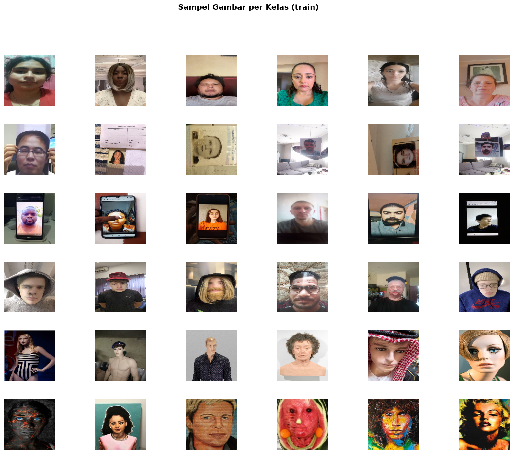
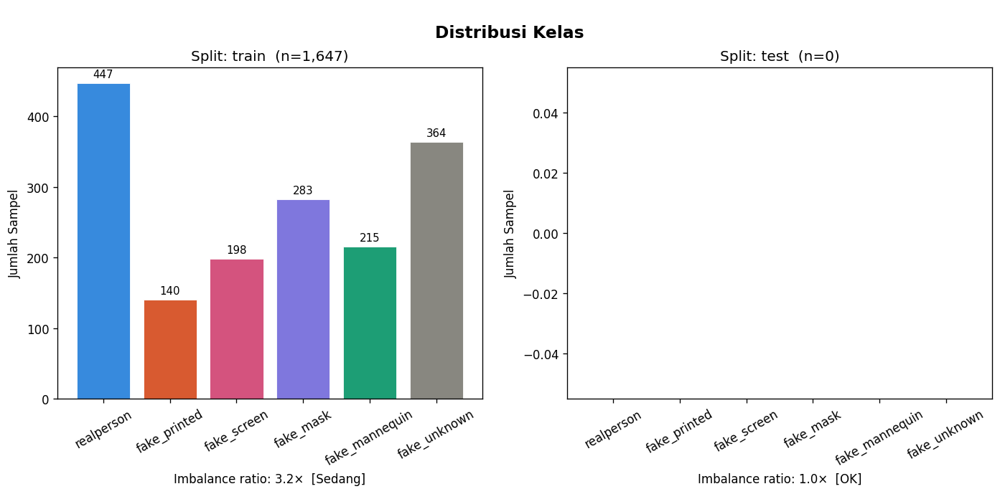
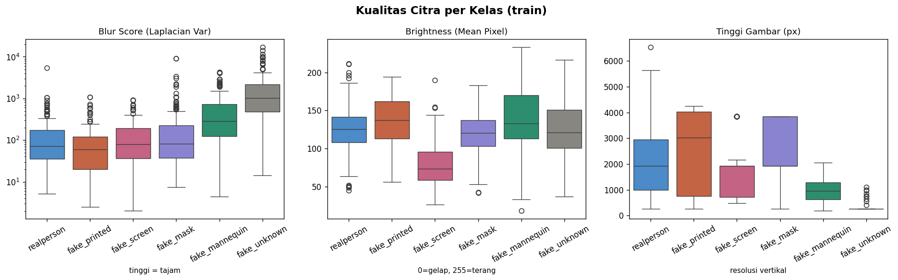
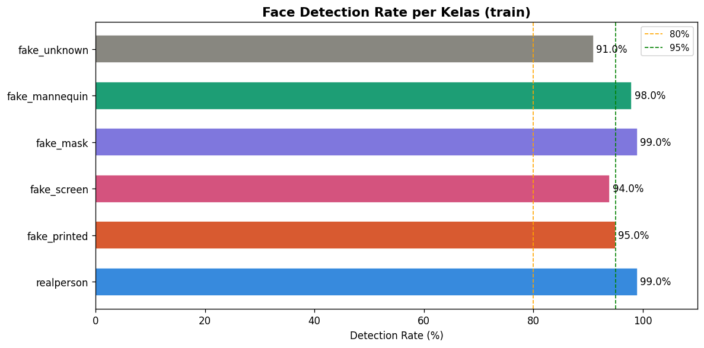
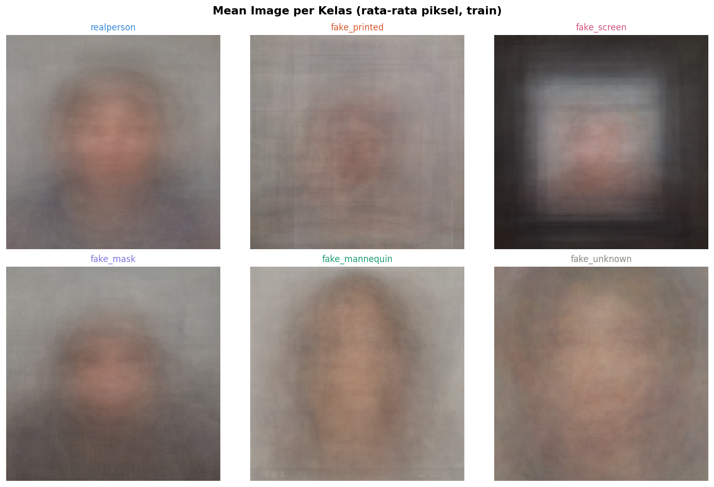
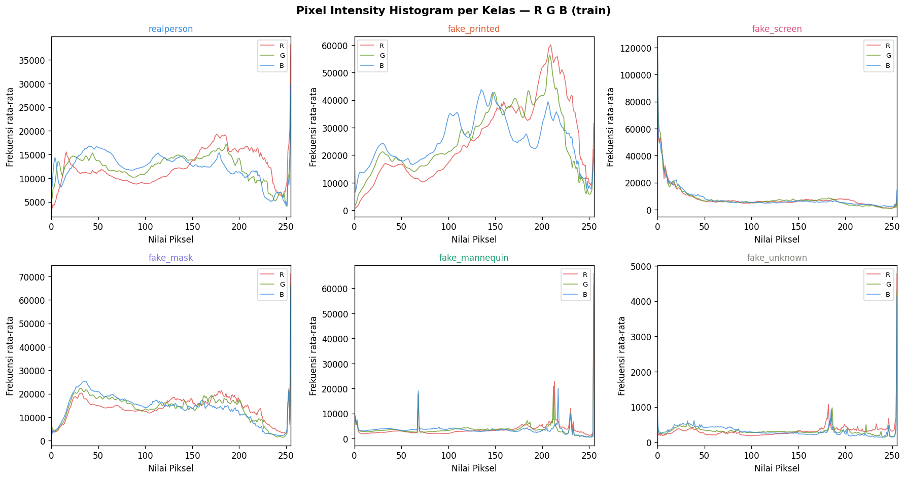
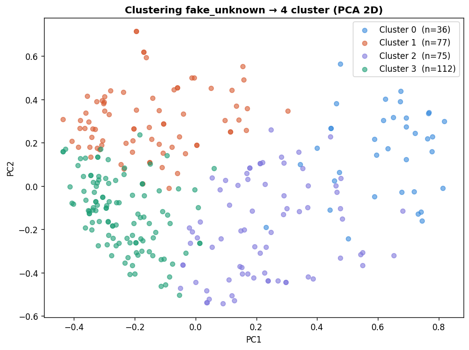

# Face Anti-Spoofing Presentation Attack Detection

Vision Transformer (ViT-B/16) pipeline with Focal Loss, MixUp/CutMix Regularization, and Pseudo-Labeling, developed for **FindIT! Data Analytics Competition (DAC) 2026** by **Team import kalah**.

---

[](https://www.python.org/)
[](https://jupyter.org/)
[](https://pytorch.org/)
[](https://github.com/huggingface/pytorch-image-models)
[](https://albumentations.ai/)
[]()
[](LICENSE)

---

## 📌 Overview

With the rapid advancement of modern biometric technologies, facial recognition systems have become ubiquitous across mission-critical domains—including mobile device authentication, access control systems, and customer identity verification (e-KYC) in financial and banking platforms. Despite their high convenience and efficiency, these systems remain fundamentally vulnerable to presentation attacks (face spoofing).

Face spoofing entails presenting counterfeit visual media (e.g., printed photographs, digital screen displays, physical masks, or 3D mannequins) to biometric sensors in order to impersonate legitimate users or evade detection. Empirical research demonstrates that without robust liveness detection mechanisms, image-based attacks achieve alarming success rates.

---

## 🎯 Competition Objectives & Target Classes

The **FindIT! DAC 2026** competition challenges participants to develop a robust, image-based computer vision model capable of distinguishing genuine human faces from five distinct physical and digital presentation attack vectors under varied illumination conditions, camera angles, and resolution constraints.

The classification task is formulated as a **6-class classification problem**:

| Label | Category | Attack Modality & Description |
| :--- | :---: | :--- |
| `realperson` | **Bona Fide** | Genuine, unmanipulated face captures of real human individuals. |
| `fake_printed` | **Print Attack** | 2D photographs printed on paper, cardboard, or photographic medium. |
| `fake_screen` | **Replay Attack** | Digital screen replays via smartphones, tablets, laptops, or LCD monitors. |
| `fake_mask` | **3D Mask Attack** | Physical wearable masks, including rigid 3D resin, latex, and silicone masks. |
| `fake_mannequin` | **Replica Attack** | Synthetic human representations such as retail mannequins, sculptures, or dolls. |
| `fake_unknown` | **Novel / Hybrid** | Mixed, hybrid, and unconventional spoofing vectors not defined in standard classes. |

---

## 🔍 Exploratory Data Analysis (EDA) & Visual Evidence

Our exploratory phase inspected the dataset across class proportions, photographic quality, sensor detection rates, and visual artifacts:

### 1. Sample Grid Across Attack Modalities

*Visual comparisons illustrating subtle texture, specular reflection, color balance, and edge artifacts differentiating bona fide faces from spoof attacks.*

---

### 2. Class Distribution

*Class frequency across training samples showing non-uniform class counts, necessitating stratified validation splitting and class-sensitive loss weighting.*

---

### 3. Image Quality Metrics (Brightness & Sharpness)

*Comparison of pixel brightness and Laplacian blur variance. Screen replay attacks exhibit distinct high-frequency moiré patterns and brightness variance, whereas mannequin attacks exhibit flatter skin reflectance.*

---

### 4. Face Detection Rates

*Automated face detection reliability per class. Spoof classes like `fake_mask` and `fake_mannequin` present lower detector confidence, underscoring the necessity of global contextual feature extraction rather than tightly cropped face priors.*

---

### 5. Mean Class Images & Pixel Histograms
<p align="center">
  
  
</p>

*Left: Mean pixel representations per category. Right: RGB channel color histograms highlighting distribution shifts across presentation media.*

---

### 6. Latent Space Clustering of `fake_unknown`

*t-SNE / PCA clustering of the open-world `fake_unknown` category, revealing multiple sub-clusters corresponding to varied unlabelled spoofing artifacts.*

---

## 🏗️ Methodology & Modeling Architecture

```
                 [ Input Image (224 × 224 × 3) ]
                               │
                               ▼
        ┌──────────────────────────────────────────────┐
        │        Domain-Specific Augmentations         │
        │ • JPEG Compression Artifacts (ImageComp)     │
        │ • RandomBrightnessContrast & ColorJitter     │
        │ • MotionBlur & ShiftScaleRotate              │
        │ • Batch-level MixUp & CutMix (p = 0.50)      │
        └──────────────────────┬───────────────────────┘
                               │
                               ▼
        ┌──────────────────────────────────────────────┐
        │      Vision Transformer Backbone: ViT-B/16   │
        │        (85.8M Params, ImageNet-21k Init)     │
        │                                              │
        │  [Patch Embed: 16×16] ──► [12 Transf Blocks] │
        └──────────────────────┬───────────────────────┘
                               │
                               ▼
        ┌──────────────────────────────────────────────┐
        │           Classification Head (6 Classes)    │
        │   LayerNorm ──► Linear(768, 6) ──► Softmax   │
        └──────────────────────┬───────────────────────┘
                               │
                               ▼
        ┌──────────────────────────────────────────────┐
        │             Optimization Engine              │
        │ • Loss: Multi-Class Focal Loss (γ = 2.0)     │
        │ • Optimizer: AdamW + Layer-wise LR Decay     │
        │ • Scheduler: CosineAnnealingWarmRestarts     │
        └──────────────────────┬───────────────────────┘
                               │
                               ▼
        ┌──────────────────────────────────────────────┐
        │     Semi-Supervised Pseudo-Labeling          │
        │  Unlabeled Test Predictions (Conf ≥ 0.85)    │
        │     Bootstrapped into Fine-Tuning Loop       │
        └──────────────────────┬───────────────────────┘
                               │
                               ▼
              [ Final Predictions with TTA ]
```

### 1. Vision Transformer Backbone (ViT-B/16)
Rather than conventional convolutional networks (CNNs), we leverage **`vit_base_patch16_224`** (ImageNet-21k pre-trained, 85.8M parameters). ViT's global self-attention mechanism is capable of attending to non-local spatial artifacts (e.g., moiré fringes, screen bezels, and paper cut edges) across the entire frame.

### 2. Tailored Domain Augmentation
Informed by our EDA findings:
- **`ImageCompression`:** Replicates lossy JPEG compression and transmission noise typical of printed materials.
- **`ColorJitter` & `RandomBrightnessContrast`:** Simulates variable screen backlighting and ambient room lighting.
- **Batch-Level MixUp & CutMix:** Prevents over-confidence on high-frequency noise and enhances decision boundary smoothness.

### 3. Layer-Wise Learning Rate Decay (LLRD)
For transformer fine-tuning, deeper layers undergo higher update rates than foundational patch embeddings:
$$\eta_l = \eta_{\text{base}} \cdot \gamma^{L - l}, \quad \text{with } \gamma = 0.75$$
This preserves general pre-trained visual representations in early layers while aggressively adapting late representations to spoof signatures.

### 4. Multi-Class Focal Loss
$$\mathcal{L}_{\text{Focal}} = -\sum_{c=1}^6 \alpha_c (1 - p_c)^\gamma \log(p_c)$$
Focuses training on hard, ambiguous spoof samples (such as high-fidelity masks and subtle screen replays) while down-weighting easy examples.

### 5. Semi-Supervised Pseudo-Labeling
To adapt to the unlabelled test distribution:
1. Predict probabilities on test images using the top checkpoint.
2. Select high-confidence samples ($p_{\max} \ge 0.85$, 254 out of 404 test samples).
3. Append pseudo-labeled samples into training set for iterative refinement.

### 6. Test-Time Augmentation (TTA)
Inference averages predictions across horizontal flips and multi-scale transformations to stabilize final predictions.

---

## 📊 Experimental Results

Cross-validated on the stratified validation fold:

| Stage / Setup | Metric | Score | Note |
| :--- | :---: | :---: | :--- |
| **Supervised ViT-B/16** (Epoch 11) | **Val F1-Macro** | **0.9739** | Loss: 0.1342 |
| **Supervised ViT-B/16** (Epoch 11) | **Val Balanced Acc** | **0.9759** | |
| **+ Pseudo-Labeling (Iteration 1)** | **Val F1-Macro** | **0.9803** | Boost from 254 confident pseudo-labels |
| **+ Pseudo-Labeling (Iteration 2)** | **Val F1-Macro** | **0.9829** | **Peak Performance** |
| **Inference Post-Processing** | **Test TTA** | Applied | Horizontal flip & intensity shifts |

---

## 📁 Repository Structure

```
face-anti-spoofing/
├── data/
│   └── README.md                                # Dataset setup instructions & class mapping
├── figures/
│   ├── class_distribution.png                   # Dataset class breakdown chart
│   ├── face_detection_rates.png                 # Detection rate comparison across classes
│   ├── fake_unknown_clustering.png              # Clustering of unknown spoof attacks
│   ├── image_quality_analysis.png               # Sharpness and brightness analysis
│   ├── mean_images_per_class.png                # Mean face visualization per category
│   ├── pixel_histograms.png                     # RGB intensity histogram analysis
│   └── sample_images_grid.png                   # Sample grid of all 6 target classes
├── notebooks/
│   └── Notebook_Team_import_kalah.ipynb         # End-to-end reproducible research notebook
├── .gitattributes                               # Git LFS configuration for models/artifacts
├── .gitignore                                   # Standard exclusions for vision data & cache
├── LICENSE                                      # MIT License
├── requirements.txt                             # Python dependencies
└── README.md                                    # Comprehensive project documentation
```

---

## 🚀 Getting Started

### 1. Installation
Clone the repository and install required packages:
```bash
git clone https://github.com/<your-username>/face-anti-spoofing.git
cd face-anti-spoofing
pip install -r requirements.txt
```

### 2. Dataset Setup
Follow the instructions in [data/README.md](data/README.md) to extract the competition images into the `data/` folder. The notebook also includes automated download commands using `gdown`.

### 3. Running the Notebook
The entire workflow (EDA, ViT-B/16 training, pseudo-labeling, and submission generation) is self-contained in:
```
notebooks/Notebook_Team_import_kalah.ipynb
```
You can run this notebook directly on **Google Colab** (using a GPU runtime like T4 or A100) or on your local machine with Jupyter:
```bash
jupyter notebook notebooks/Notebook_Team_import_kalah.ipynb
```

---

## 📜 License
This project is licensed under the [MIT License](LICENSE).

## 🤝 Acknowledgements
- **FindIT! DAC 2026** Organizing Committee.
- **Hugging Face & Timm** for Vision Transformer implementations.
- **Albumentations Team** for computer vision augmentation tools.
